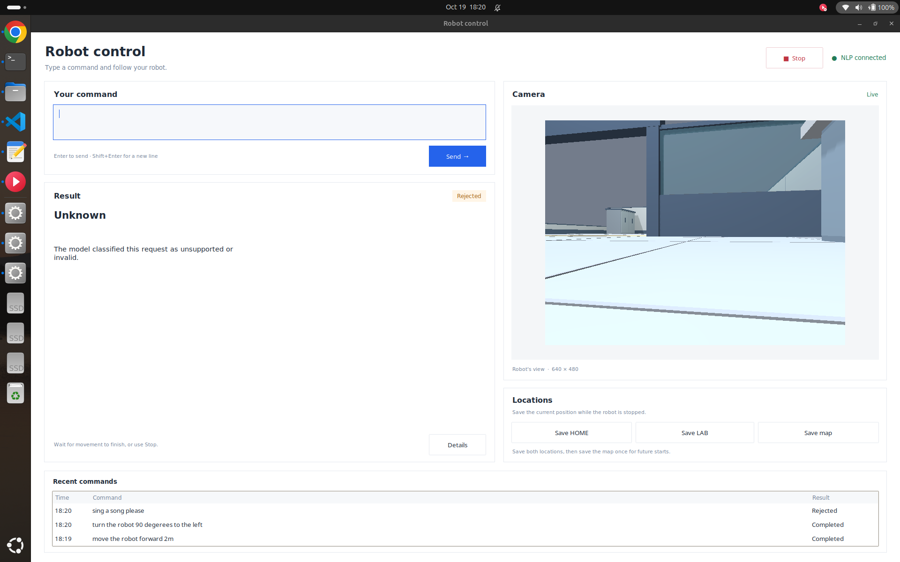
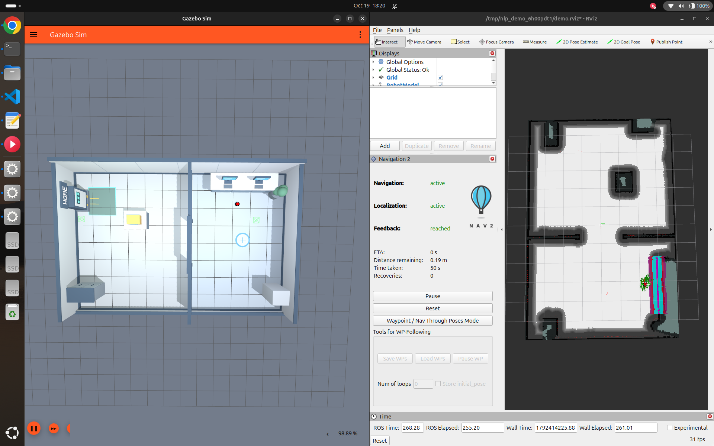
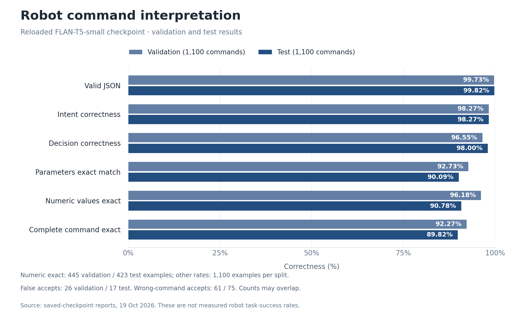

# Natural Language Robot Control with ROS 2

**ROS 2 Jazzy · Gazebo Harmonic · FLAN-T5 · Nav2 · Python**

A robot simulation controlled through typed language. A fine-tuned FLAN-T5 model converts commands into an intent, normalized parameters, and a decision. ROS 2 handlers execute movement, inspect live sensors, manage conditional safety rules, and navigate between **HOME** and **LABORATORY**.

## Demo

[](https://github.com/Harivathsha/ros2-natural-language-control/releases/download/demo-v1/robot_demo.mp4)

**[Watch or download the full demonstration](https://github.com/Harivathsha/ros2-natural-language-control/releases/download/demo-v1/robot_demo.mp4)**

The desktop interface includes a live camera view, command results, recent commands, a Stop button, and controls for saving the map and destinations. The full video and trained checkpoint are provided in the [demo release](https://github.com/Harivathsha/ros2-natural-language-control/releases/tag/demo-v1).

## Features

| Area | Supported operations |
|---|---|
| Motion | Forward/backward movement, optional linear speed, left/right turns, and stop |
| Sensor checks | LiDAR, camera, and IMU health, rate, freshness, data validity, nearest obstacle, and camera resolution |
| Conditional safety | Create, list, remove, and clear rules monitored against live sensor readings |
| Navigation | Travel to HOME or LABORATORY using Nav2 and reuse a saved map across restarts |

The model learns spelling variations, phrasing, and numerical/unit normalization from annotated examples. It predicts directly from the input text. Output schema checks and robot limits remain in code; they do not interpret input keywords or correct spelling.

For example, the demonstrated command `move the bot foward 0.65m at 0.12m/s pls` produces:

```json
{
  "decision": "VALID",
  "intent": "MOVE_DISTANCE",
  "parameters": {
    "action": "MOVE",
    "direction": "FORWARD",
    "distance_m": 0.65,
    "speed_mps": 0.12
  }
}
```

The NLP node publishes structured results on `/nlp/result`. The appropriate handler reports execution progress on `/nlp/execution_result`. Nav2 velocity commands pass through the motion handler before reaching `/cmd_vel`.

## Environment and saved locations



The world contains a charging-station area and a laboratory destination. **HOME** is the saved parking pose near the charging station. Navigating there demonstrates a return to that pose; physical charger docking and battery charging are outside this project.

The saved environment is a matched set in `artifacts/saved_environment/`: `map.pgm`, `map.yaml`, and `named_locations.json`. Keep these three files together. The launch loads the saved map with AMCL; without a saved environment, it starts SLAM mapping.

## Model and results

The final corpus contains **9,500 commands and 17 intents**, with 7,300 training, 1,100 validation, and 1,100 test examples. It includes clean commands, typing mistakes, informal phrasing, numerical notation variants, and invalid or incomplete requests.

The active model is **`google/flan-t5-small`**, fine-tuned to generate command JSON. The workbook also retains BIO annotations from the earlier slot-tagging experiment. This semantic model trains on the text and command JSON targets.



The saved **`semantic_phase2_typing`** checkpoint was reloaded and evaluated without retraining on 1,100 validation and 1,100 test commands. The validation scores reproduce the selected epoch 9 training log.

| Metric | Validation | Test |
|---|---:|---:|
| Valid JSON | 99.73% | 99.82% |
| Intent correctness | 98.27% | 98.27% |
| Parameters exact match | 92.73% | 90.09% |
| Decision correctness | 96.55% | 98.00% |
| Complete command exact match | **92.27%** | **89.82%** |
| Numeric values exact match | 96.18% | 90.78% |

Complete command match requires the intent, all parameters, and the final decision to match the reference: **1,015/1,100 validation commands** and **988/1,100 test commands**. Numeric exact match uses only examples with numeric parameters: 445 validation and 423 test commands. Decisions are scored after schema checks, robot limits, and the confidence threshold used by the evaluator.

The test is the annotated corpus's test split. These scores measure command interpretation, not navigation or physical robot success. Generated-token confidence is not calibrated command correctness.

**Remaining errors:** validation recorded 26 false accepts and 61 accepted commands with incorrect intent or parameters; test recorded 17 and 75, respectively. A false accept means the final decision was VALID when the reference required rejection or clarification. These counts can overlap. Missing directions, numeric copying, and rule-ID copying remain limitations.

The original [validation report](docs/results/validation_metrics.json), [test report](docs/results/test_metrics.json), and [evaluation metadata](docs/results/evaluation_metadata.json) are included. The metadata records dataset and checkpoint SHA-256 fingerprints and package versions. Error examples are available in [validation_errors.csv](docs/results/validation_errors.csv) and [test_errors.csv](docs/results/test_errors.csv).

## Installation

Tested platform: **Ubuntu 24.04, ROS 2 Jazzy, Gazebo Harmonic, and Python 3.12**. A CUDA GPU is optional. The following assumes ROS 2 Jazzy is already installed.

```bash
sudo apt update
sudo apt install -y python3-venv python3-pip python3-tk \
  python3-colcon-common-extensions curl \
  ros-jazzy-ros-gz ros-jazzy-xacro ros-jazzy-robot-state-publisher \
  ros-jazzy-rviz2 ros-jazzy-navigation2 ros-jazzy-nav2-bringup \
  ros-jazzy-slam-toolbox

mkdir -p ~/ai_envs/project
git clone https://github.com/Harivathsha/ros2-natural-language-control.git \
  ~/ai_envs/project/ros2-natural-language-control
cd ~/ai_envs/project/ros2-natural-language-control
source /opt/ros/jazzy/setup.bash

python3 -m venv --system-site-packages .venv
source .venv/bin/activate
python -m pip install -r requirements.txt
colcon build --symlink-install --packages-select description_new navigation nlp_files
```

An existing working Python environment can be reused. `--system-site-packages` lets a new environment use ROS's system-installed Python bindings. Retain a working CUDA/PyTorch installation when reusing an environment.

Download the published model:

```bash
mkdir -p artifacts
curl -fL \
  https://github.com/Harivathsha/ros2-natural-language-control/releases/download/demo-v1/semantic_phase2_typing.tar.gz \
  -o /tmp/semantic_phase2_typing.tar.gz
tar -xzf /tmp/semantic_phase2_typing.tar.gz -C artifacts
```

The model folder must contain its weights, tokenizer files, configuration, and `command_schema.json`. It is kept outside Git history and distributed through the release.

## Run in three terminals

Run this preparation block in **each terminal**. If using another Python environment, replace the `.venv` activation line.

```bash
cd ~/ai_envs/project/ros2-natural-language-control
source /opt/ros/jazzy/setup.bash
source install/setup.bash
source .venv/bin/activate
export NLP_PROJECT_ROOT="$PWD"
export PYTHONPATH="$PWD/src/nlp_files:$PYTHONPATH"
```

**Terminal 1 — simulation**

```bash
ros2 launch description_new phase2_sim.launch.py rviz:=false
```

**Terminal 2 — NLP, handlers, localization/mapping, Nav2, and RViz**

```bash
ros2 launch "$PWD/nlp_demo.launch.py"
```

**Terminal 3 — desktop interface**

```bash
python -m nlp_files.ros_nodes.robot_ui
```

Wait for **NLP connected**, type a command, and wait for completion before the next movement. Use the Stop button to interrupt motion.

| Try | Example |
|---|---|
| Movement with a typing mistake | `move the bot foward 0.65m at 0.12m/s pls` |
| Backward movement | `move the robot backwards 0.2m please` |
| Turn | `turn the robot 90 degrees to the right` |
| Sensor health | `how is the lidar` |
| Camera information | `what is the camera resolution` |
| Obstacle distance | `where is the nearest obstacle` |
| Named navigation | `go home` or `go lab` |
| Rule management | `list safety rules` |

The interface limits individual moves to **2 m**, linear speed to **0.3 m/s**, and individual turns to **180 degrees**. Model interpretation of an unfamiliar command can still be wrong.

### Create or replace a map

To deliberately start a new mapping session, replace the terminal 2 command with:

```bash
ros2 launch "$PWD/nlp_demo.launch.py" mapping:=true
```

Explore the route, stop at the charging station and select **Save HOME**, then stop at the laboratory and select **Save LAB**. Finally select **Save map** and wait for the saved message before shutting down. The next normal launch reloads that map and both locations.

Automatic initialization assumes the robot starts at the recorded HOME pose. The provided simulation uses its usual HOME spawn. If starting elsewhere, set the robot pose with RViz's **2D Pose Estimate**. A changed world requires a matching new map and destinations. Conditional safety rules are stored in memory for the current run.

## Training and evaluation

The included workbook is `dataset_phase2_9500.xlsx`. To train a separate checkpoint without replacing the published one:

```bash
python -m nlp_files.training.train_semantic_model dataset_phase2_9500.xlsx \
  --output-dir artifacts/semantic_phase2_retrained \
  --epochs 10 --batch-size 8 --lr 3e-4
```

To evaluate the downloaded checkpoint on the workbook's validation split:

```bash
python -m nlp_files.training.train_semantic_model dataset_phase2_9500.xlsx \
  --output-dir artifacts/semantic_phase2_typing --evaluate-only \
  --errors-file outputs/semantic_validation_errors.csv
```

This command evaluates validation. The published test report was generated separately from the same reloaded checkpoint using the evaluator on the workbook's test rows. A new training run can produce different results. Use `model_path:=artifacts/semantic_phase2_retrained` in the terminal 2 launch to try a retrained model.

## Repository contents

| Path | Purpose |
|---|---|
| `src/nlp_files/` | Semantic pipeline, dataset loader, trainer, ROS handlers, and UI |
| `src/description_new/` | Robot description, meshes, camera/bridge, and two-location world |
| `src/navigation/` | Nav2/SLAM configuration and RViz view |
| `artifacts/saved_environment/` | Matched map and two saved poses |
| `docs/` | Two demonstration screenshots, validation/test reports, and results graph |
| `nlp_demo.launch.py` | Terminal 2 bringup |

Build products, environments, caches, previous models, and raw recordings are excluded. This is a simulation learning project with a finite command interface. Independent testing of new phrasing, numbers, and identifiers remains future work.

Developed by [Harivathsha Ramesh](https://github.com/Harivathsha).
